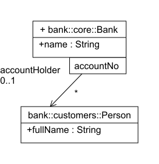
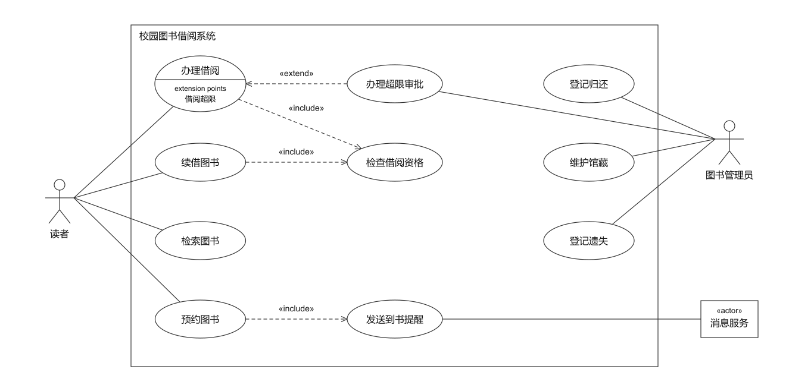
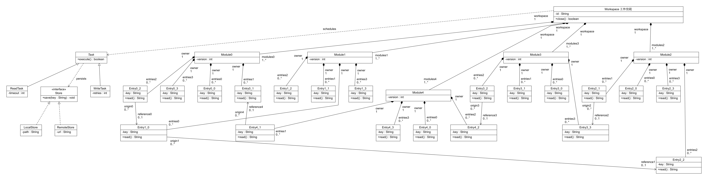
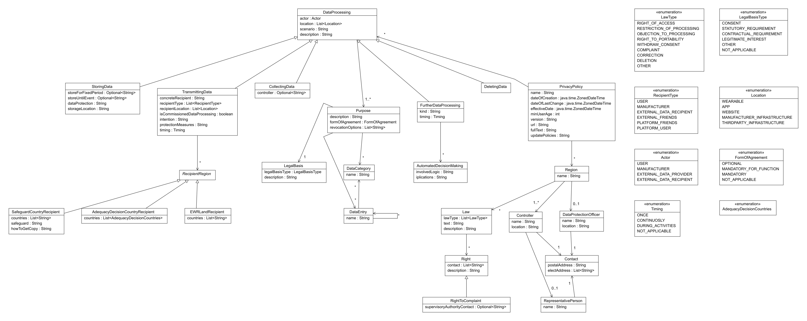

# Clean UML Lab

从结构化事实生成简洁、可审核的 UML 类图和用例图，输出 **SVG、PNG 和可编辑 draw.io**。可作为 agent skill 或本地 CLI 使用。

本分支包含阶段 **4.4** 核心、**4.6 路由/标签优化**、**4.7 原生重连**、**4.8 字体位置搜索**和 **4.9 标签计算优化**。支持文字自动扩框、保存后的编辑重排、一次最终 PNG 导出和实图文字审核。已发布的 `v0.1.0-alpha.1` 对应阶段 4.2。



## 使用

用例图阶段入口：

```sh
npm ci --prefix runtime --no-audit --no-fund
python usecase.py examples/usecase-library.json -o out/usecase-library
python verify_usecase.py out/usecase-library
```

用例图按参与者职责和关系安排位置，保持黑白样式，优先直线和短斜线。支持关联、include、extend 和泛化；extend 需要明确的扩展点。模型和限制见 [usecase-model.md](runtime/references/usecase-model.md)。原生文件可编辑，类图的 reflow 命令不适用于用例图。固定案例及独立消融可用 `python benchmarks/usecase_ablation.py -o new-study` 复现。



8 个固定合成场景的 32 组独立消融保留全部事实，完整配置 7/8 通过几何检查；门诊场景保留 1 处交叉并返回需要复查。复杂电商场景为 0 处交叉，同内容 PlantUML 自动布局为 9 处，但本工具占用面积更大；门诊场景 PlantUML 自动布局没有交叉。8 份原生文件的保存后语义检查、移动连接和文字编辑保存通过。实图字体测量未发现文字越出用例椭圆。详见 [阶段证据](docs/usecase-evidence.json)；这些结果不代表独立技能评测或人类审美认证。

需要 Python 3.12+、Node.js 22+。在仓库目录执行：

```sh
npm ci --prefix runtime --no-audit --no-fund
python runtime/scripts/doctor.py
python prototype.py examples/qualified-bank.json --root Bank -o out/bank
```

打开 `out/bank/diagram.png`，在 draw.io 中打开 `out/bank/diagram.drawio` 编辑。输出目录必须是新目录；安装依赖后，生成可离线运行，无需 API key。中文需要系统提供中文字体。

```sh
python prototype.py examples/team.json --requirements examples/team.requirements.json -o out/team
python prototype.py examples/InviDas.json -o out/invidas
```

`run.json` 记录候选、选中结果和检查状态。`selected_valid=false` 返回退出码 2；通过自动检查的复杂图仍可能有交叉、长线或空白，需要读图确认。生成阶段先审核 SVG 候选，只栅格化最终结果一次；`--candidate-previews` 可在选择后额外生成候选 PNG。

将仓库放入 agent 的 `skills/clean-uml-lab/` 目录，并安装 runtime 依赖，即可使用 [SKILL.md](SKILL.md)。例如：

> 使用 $clean-uml-lab，根据需求画 UML 类图，保留角色、多重性和方向，输出 draw.io、SVG、PNG，并报告未通过的检查。

模型格式见 [model.md](runtime/references/model.md)。不要为布局补充或删除业务事实。

当常规类图候选全部失败时，可执行一次端部空间修正：分层安排组合分支起点，并尝试调整放不下标签的普通关联。完整语义、类框和检查标准保持不变。`--no-fan-clearance`、`--no-association-clearance` 可独立关闭；`run.json` 区分内部返工和人工返工。两个开发失败案例恢复了完整输出，但新留出样本未显示稳定收益，复杂图仍有交叉，不能据此宣称领先竞品。[修正证据](docs/end-clearance-evidence.json)。

## 编辑与重排

原生标题和成员文字编辑会扩展类框，限定符保持为真实连接端。更长的文字仍可能与邻近对象相撞。保存后，用匹配的原始输出模型重排：

```sh
python reflow.py edited.drawio --model out/bank/model.json -o out/bank-reflow
```

支持类名、成员行、角色、多重性、关系标签和限定符文字的修改。将普通连接端拖到已有类框或文字行后，使用 `--allow-reconnect` 导入重连；限定符端仍固定归属，另一侧的普通端可以重连。导入记录逐项列出改动，关系种类、箭头、角色与多重性保持原值，继承循环等无效连接会被拒绝。新增/删除类、改变 UML 类型或限定符归属仍未支持。重排保留源文件，生成新模型和新图，替换手动坐标。不是与 JSON 的实时同步。

可直接运行原生保存的重连样例：

```sh
python verify_reconnect.py
python reflow.py examples/native-reconnect.drawio --model examples/native-reconnect.model.json --allow-reconnect -o out/native-reconnect
```

17 个固定 draw.io 原生 API 保存/重载样例、34 次严格/重连导入检查和 4 次完整重排均通过。包含普通端、文字行端、组合源端、自关联、限定符另一端及无效修改；未改的命名空间保留原始格式。验证中修过一次模型比较脚本和一次命名空间格式保留问题，首次中断记录保留。[重连证据](docs/native-reconnect-evidence.json)。这些是本机原生 API 检查，未认证完整桌面 GUI，也不代表复杂图布局已经提升。

## 实图文字审核

可选工具需要 Node.js 22.12+、已安装的 Chrome/Chromium/Edge 和 Puppeteer Core：

```sh
npm install --prefix out/review-runtime puppeteer-core@25.10.0 --no-audit --no-fund
node review_svg.cjs out/bank/diagram.svg --model out/bank/model.json --engine clean --output out/bank-review --puppeteer-module ./out/review-runtime/node_modules/puppeteer-core
```

也可审核带完整同源模型的 PlantUML/Mermaid 类图 SVG，分别用 `--engine plantuml`、`--engine mermaid`。工具在独立离线浏览器中量取文字边界；无冲突为退出码 0，需要检查为 2，执行失败为 3。它检查文字边界冲突，不认证像素重叠、角色归属、业务事实或人类审美。

可选一键路由与标签优化：

```sh
npm ci --prefix refinement --no-audit --no-fund
python refinement/create_uml.py examples/InviDas.json -o out/invidas-refined
```

它保持类框和完整语义，尝试自然斜线与较少折点的连接，并优化标签。原图、新路线分别测量文字边界，再实测最终结果；通常 2–3 次，实际回退最多 4 次。搜索中不调用浏览器、不导出 PNG，最终 PNG 只导出一次。路线的标签提示须通过旧标签流程的验收基线；新增标签优化不能撤销旧流程已接纳的绕线改善。`--no-routes`、`--no-prefix-routing`、`--no-crossing-tradeoff` 可分别消融路由、路径前缀和交叉取舍；原有标签消融开关保留。

新增标签位置搜索复用已量取的真实字体边界，保留类框、连线、文字和字体，只移动有距离提示的标签。每次最多 12 个标签、每标签 96 个位置、10,000 个搜索状态；搜索不增加浏览器或 PNG 调用。`--no-font-domains` 关闭新增搜索，`--no-measured-fragments` 和 `--no-dense-prefix` 分别消融实测片段与密集前缀采样；`--no-refine` 关闭全部标签优化。

阶段 4.8：8 个已知场景（7 个模型）的 32 组机制消融通过原生和几何检查；完整命令曾发现一次路线回退，修正后 5 组配对验证均不增加几何指标或标签提示。32 类模块图交叉 3→1、折点 3→2、标签提示 5→4；租赁图提示 1→0，履约图 2→1。模型事实保留，字体测量与 PNG 次数不增加。[本轮证据与边界](docs/font-domain-evidence.json) · [已有路由证据](docs/route-evidence.json)。这是已知案例与合成家族的工程结果，复杂图宽度、残余交叉与人类审美仍待改进。

阶段 4.9：复用未改变的标签验收分数，只尝试仍有距离提示的标签对齐；无法确认标签绑定时保留完整检查。4 个已知场景的 16 组独立消融均与旧版的 SVG、draw.io、图数据和优化决策一致。固定 32 类生成结果的四次往返计时中，优化段中位耗时 30.14→19.52 秒，SVG/draw.io/PNG 逐字节一致。完整生成的单次配对没有显示整体加速；新采样的一个 37 类模型在两版中都生成失败，失败记录保留。`--no-alignment-score-reuse` 和 `--no-affected-alignment` 可独立消融。[计算优化证据](docs/alignment-evidence.json)。这项改变不提升布局或认证审美。

可直接运行的 32 类例子：

```sh
python refinement/create_uml.py examples/module-workspace.json --root workspace -o out/module-workspace
```

[SVG](docs/images/module-workspace.svg) · [可编辑 draw.io](docs/images/module-workspace.drawio)



## 验证与边界

| 阶段 4.4 检查 | 结果与范围 |
| --- | --- |
| 复制技能包运行 | 3 个公开例子生成、1 个保存后的 Bank 文本重排，4/4 通过；都是已有开发案例 |
| 全新依赖树 | Windows 本机新工作树执行 npm ci；环境/语义检查、3 个示例与 1 个保存文件重排全部通过，操作系统和字体沿用 |
| 延后 PNG 导出的配对消融 | 6 个案例、12 次调用、批内返工 0；导出次数 16 → 6，最终 SVG/draw.io/PNG 和候选选择逐字节一致；不是总体延迟降低 62.5% |
| 实图审核 CLI | 从 ZIP 解压后运行 4 次，Clean/Mermaid 订单图无边界冲突，PlantUML 同事实订单图报告 17 对文字边界冲突；只代表这些固定场景 |
| 原生编辑验证 | 有原生 Graph/mxCodec API 的移动、保存、重载和命中证据；复杂编辑仍有失败案例，未认证完整桌面 GUI 操作 |

[阶段证据](docs/stage-4.4-evidence.json) · [首次公开版本历史记录](docs/release-evidence.json) · [Windows/Linux 安装与导出 CI 模板](docs/ci-smoke.yml)。当前 GitHub 授权不含 workflow 权限，模板尚未启用；远端 CI 未验收。

```sh
python verify_semantics.py out/semantic-probes
```

当前支持类、接口、抽象类、普通枚举、继承/实现/关联/聚合/组合/依赖、关联导航、显式命名空间和导入类型、有序关联端、单个命名属性限定符。尚不覆盖完整 UML：包框、多属性/类型限定符、枚举操作、时序图和活动图等未实现。

复杂布局正在继续研究。现有证据不支持“全面领先所有竞品”；几何指标和工程检查不等于人类偏好、理解效率或独立绘图 skill 的盲测结果。

## 许可与例图

代码和自建例子为 [MIT](LICENSE)。InviDas 原始模型、投影及生成图源于 CC BY 4.0 数据，作者和修改说明见 [ATTRIBUTION.md](examples/ATTRIBUTION.md)，该署名许可继续适用。许可未明确的研究输入没有随仓库发布。



[可编辑工业例图](docs/images/InviDas.drawio) · [SVG](docs/images/InviDas.svg) · [中文小例子](docs/images/team.png)

[标签优化后的 InviDas SVG](docs/images/InviDas-refined.svg) · [对应 draw.io](docs/images/InviDas-refined.drawio)

[路由与标签优化后的 InviDas](docs/images/InviDas-routed.png) · [SVG](docs/images/InviDas-routed.svg) · [draw.io](docs/images/InviDas-routed.drawio)。该图修改了连线与标签位置，模型事实保留；继续按上述作者署名与 CC BY 4.0 许可使用。
